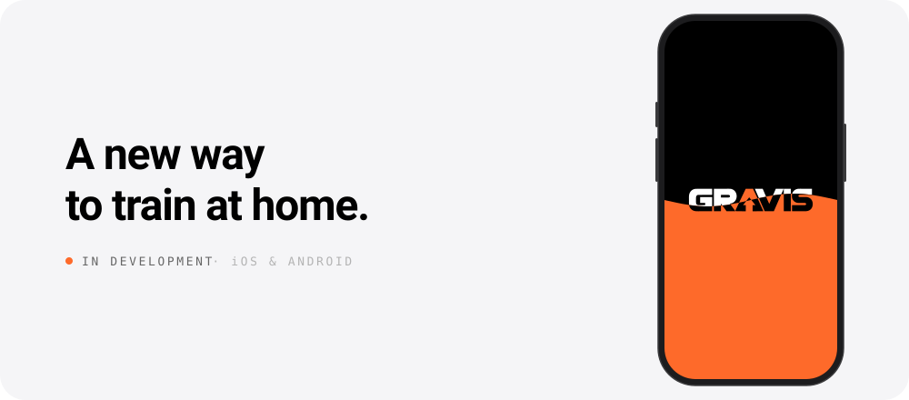

<!-- Generated by `python -m engine build`; edit engine/ instead. -->

<picture>
  <source media="(prefers-color-scheme: dark)" srcset="https://raw.githubusercontent.com/gravisapp/.github/main/profile/assets/hero-dark.svg?v=7c9e5695">
  
</picture>
