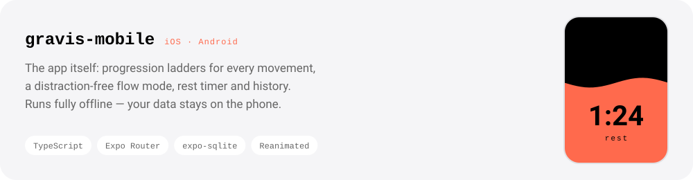

<!-- Images are generated: python -m engine build. Text below can be edited freely. -->

<picture>
  <source media="(prefers-color-scheme: dark)" srcset="./assets/hero-dark.svg">
  
</picture>

<picture>
  <source media="(prefers-color-scheme: dark)" srcset="./assets/chips-dark.svg">
  
</picture>

<picture>
  <source media="(prefers-color-scheme: dark)" srcset="./assets/div-about-dark.svg">
  
</picture>

Gravis is an open-source workout app for training at home with your body weight and whatever is around:
a pull-up bar, two chairs, a backpack. Every movement is a **ladder**, from wall push-ups to one-arm
push-ups, and the app moves you to the next step once you own the current one. No gym, no subscription
wall around the basics, and your data stays on your phone.

<picture>
  <source media="(prefers-color-scheme: dark)" srcset="./assets/div-projects-dark.svg">
  
</picture>

<a href="https://github.com/gravisapp/gravis-mobile">
  <picture>
    <source media="(prefers-color-scheme: dark)" srcset="./assets/project-mobile-dark.svg">
    
  </picture>
</a>

<picture>
  <source media="(prefers-color-scheme: dark)" srcset="./assets/div-roadmap-dark.svg">
  
</picture>

<picture>
  <source media="(prefers-color-scheme: dark)" srcset="./assets/roadmap-dark.svg">
  
</picture>

  Ideas, bugs and pull requests are welcome — start with an issue in <a href="https://github.com/gravisapp/gravis-mobile/issues">gravis-mobile</a>.

